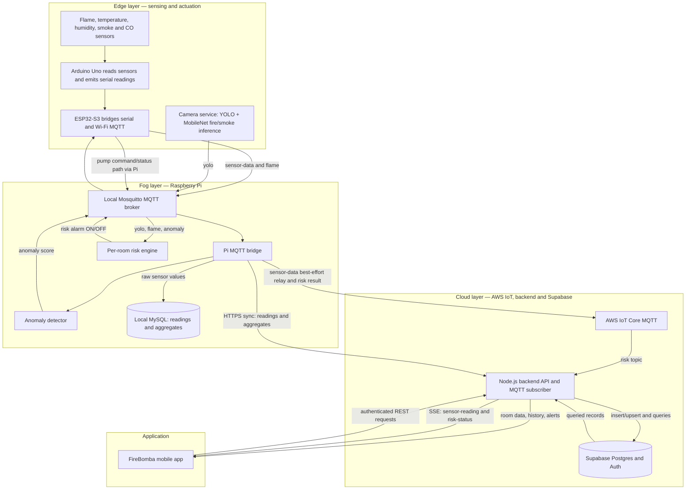

# FireBomba Architecture Flow

This document describes the implemented data path from fire sensing through the Raspberry Pi risk engine, cloud services, Supabase, and the mobile application.

## At a glance



## 1. Edge layer: detect and publish

1. The Arduino Uno samples the flame, DHT, smoke and CO sensors, applies its local thresholds, and sends readings and alert labels over the serial connection to the ESP32-S3.
2. The ESP32-S3 packages readings as JSON with `deviceId`, `roomId`, `flame_detected`, `temperature`, `humidity`, `smoke` and `co`. Every five seconds it publishes to the local MQTT broker on `firebomba/room/<room_id>/sensor-data`; it separately publishes a binary flame value on `firebomba/room/<room_id>/flame`.
3. The camera service runs YOLO detection followed by MobileNet classification. It publishes connection state and confirmed detection confidence on `firebomba/room/<room_id>/yolo`. Camera frames and images are not sent to Supabase through this pipeline.
4. The ESP32 listens for local pump and risk alarm commands. Risk alarm commands are passed to the Uno over serial to operate its LED and buzzer. Pump control remains a separate command path.

## 2. Fog layer: Raspberry Pi processing

The Pi runs the local MQTT broker and the Python MQTT bridge (`raspberry/mqtt/mqtt.py`). It consumes the ESP32 sensor topic and the camera, flame and anomaly topics.

### Raw sensor persistence and anomaly calculation

- The bridge resolves `deviceId` to a room using the Pi's local MySQL `Rooms` mapping, then inserts each valid `sensor-data` message into local `SensorReadings`.
- The per-room anomaly detector calculates an anomaly score from the incoming temperature, humidity, smoke and CO values. The bridge publishes that score on `firebomba/room/<room_id>/anomaly` for the risk engine and appends diagnostic model output to a local CSV file.
- Every five minutes, the bridge builds windowed averages in local MySQL `SensorAggregates`. Readings and aggregates are therefore buffered at the Pi if its internet connection is unavailable.

### Risk calculation and alarm

The risk engine keeps a latest-value cache per room and evaluates ready rooms every five seconds. In normal camera mode it calculates:

```text
risk_score = 0.3 × yolo_confidence + 0.4 × flame_detected + 0.3 × anomaly_score
```

If five consecutive camera messages report a disconnected camera, the engine switches to sensor-only mode:

```text
risk_score = 0.6 × flame_detected + 0.4 × anomaly_score
```

Five consecutive connected camera predictions restore normal mode. Input values must be fresh (at most 30 seconds old by default); the engine skips a room if required values are missing or stale. Scores below `0.45` are Normal, scores from `0.45` through `0.75` are Warning, and scores above `0.75` are Critical. A detected flame enforces at least Warning.

Each ready result is published with its room, timestamp, component inputs and severity to AWS IoT Core at `firebomba/room/<room_id>/risk` (QoS 1, non-retained). Independently of cloud connectivity, the Pi sends repeated `ON`/`OFF` alarm commands over the local broker; Critical means ON, while fresh Warning or Normal means OFF. The ESP32 forwards the risk alarm state to the Uno.

## 3. Cloud layer: AWS IoT, backend and Supabase

AWS IoT Core provides the MQTT link between the Pi and backend. The Pi uses TLS client credentials. The backend MQTT service subscribes to the cloud risk topic and receives live risk results; risk messages are validated for score, severity, timestamp freshness and ordering. Accepted risk messages are kept in the backend's in-memory latest-risk cache and broadcast to connected app clients. **The current risk stream does not insert every risk score into Supabase.**

The Pi also forwards live raw sensor messages to AWS IoT on a best-effort basis for cloud consumers. That forwarding does not block local MySQL storage. The persistent sensor-history synchronization uses a separate HTTPS path:

1. The Pi periodically reads unsynced local MySQL sensor readings and posts them to the backend `/api/sync/insert-sensor-readings` endpoint. Five-minute aggregates are sent to `/api/sync/insert-sensor-aggregates`; failed aggregate sends are retried.
2. The Node.js backend validates the payload and calls Supabase through its server-side Supabase client.
3. Raw readings are inserted into `sensor_readings`. Aggregates are upserted into `sensor_aggregates` using the room and window start as the conflict key. The Pi updates its local sync status when the request succeeds or fails, retaining failed rows for a later retry.
4. A recent non-backlogged flame reading can create a `Fire Detected` alert. A valid live Critical risk update can create a `Critical Fire Risk` alert, once per Critical episode in the backend process. Alert records, per-user notification rows, and user read/hidden state are stored in Supabase. Push delivery is initiated by the backend alert service.

Supabase is also the backend's primary cloud data store for rooms, user profiles, sensor history, aggregates, alerts, and notifications. The backend enforces authentication and room access for application routes. The mobile client has a Supabase configuration for authentication, while sensor and room data flows through the backend API and its access checks.

## 4. Application: retrieve, stream and display

- The mobile app calls authenticated backend REST endpoints to retrieve room information, latest readings, sensor history, aggregates, and alerts. The backend queries Supabase and returns the authorized result.
- For room detail, the app opens `/api/room-detail/sensor-readings/stream?roomId=<id>` as an authenticated Server-Sent Events (SSE) connection. The backend checks room access, sends recent readings loaded from Supabase, then forwards new sensor readings as they arrive.
- The same SSE connection carries live `risk-status` events from the backend MQTT subscriber. A newly connected client can receive the latest still-fresh risk result held in backend memory. The app displays the normalized 0–100 score and severity. A missing or stale result is shown as waiting/unavailable.
- The sensor history view obtains persisted aggregate data through backend endpoints/streams; it does not depend on the Pi's in-memory risk cache.
- Alerts are retrieved from the backend using Supabase `alert_notifications` and `user_notifications` records. The backend also sends push notifications for fire alerts.

## Supabase data flow summary

| Data | Insert/update path | Retrieval path | Supabase table(s) |
|---|---|---|---|
| Raw sensor readings | Pi MySQL outbox → HTTPS sync endpoint → backend model | Backend room/history queries and initial SSE history | `sensor_readings` |
| Five-minute sensor aggregates | Pi MySQL aggregate queue → HTTPS sync endpoint → backend upsert | Backend aggregate/history queries and streams | `sensor_aggregates` |
| Fire and critical-risk alerts | Backend alert service after validated fire/risk event | App alert API; backend joins user notifications with alert and room | `alert_notifications`, `user_notifications` |
| Live risk status | AWS IoT MQTT → backend memory → SSE; not persisted as a risk-history row in this flow | App receives `risk-status` SSE event; latest value is replayed while fresh | None for the live score itself |
| Users, rooms, profiles and auth data | Backend and Supabase Auth operations | Backend authenticated API (and Supabase Auth client for sign-in flows) | `users`, `rooms`, related auth tables |

## Main message and API paths

| Path | Purpose |
|---|---|
| `firebomba/room/<room_id>/sensor-data` (local MQTT) | ESP32 sends full sensor reading; Pi stores locally and relays live to AWS IoT |
| `firebomba/room/<room_id>/flame` (local MQTT) | ESP32 sends binary flame input directly to risk engine |
| `firebomba/room/<room_id>/yolo` (local MQTT) | Camera service sends camera state and detection confidence to risk engine |
| `firebomba/room/<room_id>/anomaly` (local MQTT) | Pi anomaly detector sends score to risk engine |
| `firebomba/room/<room_id>/risk` (AWS IoT MQTT) | Pi sends calculated live risk to backend |
| `firebomba/room/<room_id>/alarm/command` (local MQTT) | Pi tells ESP32/Uno to activate or clear the local risk alarm |
| `/api/sync/insert-sensor-readings` | Pi syncs buffered raw readings to backend and Supabase |
| `/api/sync/insert-sensor-aggregates` | Pi syncs buffered five-minute aggregates to backend and Supabase |
| `/api/room-detail/sensor-readings/stream?roomId=<id>` | App receives authorized sensor-reading and risk-status SSE events |

## Implementation references

- Pi MQTT bridge and local database writes: `raspberry/mqtt/mqtt.py`, `raspberry/mqtt/database.py`
- Pi-to-cloud retry/sync worker: `raspberry/sync/sync.py`
- Risk engine: `raspberry/risk_detection/engine.py`, `raspberry/risk_detection/service.py`
- Device publisher: `arduino_script/mosquitto_mqtt_communication/mosquitto_mqtt_communication.ino`
- Backend sync routes and Supabase writes: `backend/src/controller/syncController.js`, `backend/src/models/SensorReading.js`, `backend/src/models/SensorAggregate.js`
- Cloud MQTT and live risk forwarding: `backend/src/services/mqttService.js`, `backend/src/services/riskStatusStream.js`
- App sensor/risk SSE endpoint: `backend/src/controller/roomDetailController.js`
